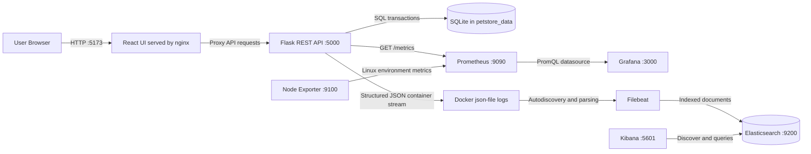
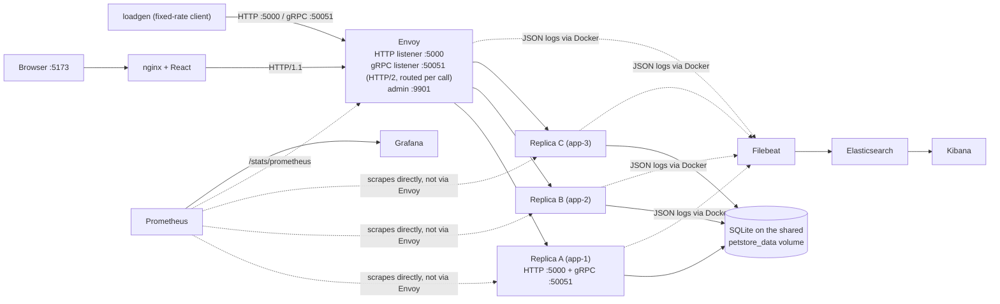

# Paws & Cart / Online Pet Store

A small online pet store project built with a Flask API, SQLite persistence, and a React + Vite frontend, instrumented end-to-end with Prometheus, Grafana, and the Elastic Stack (Filebeat, Elasticsearch, Kibana).

> **Assignment 3 (current state of the code):** the REST API and the gRPC service now run together as
> three replicas (A, B, C) behind an **Envoy** proxy on ports 5000 (HTTP) and 50051 (gRPC). The
> `backend` and `grpc-service` containers mentioned in the Assignment 1 and 2 sections below were
> replaced by the scaled `app` service. See [Assignment 3](#assignment-3---load-balancing-and-observability-with-envoy).

## Part A: Problem, users, and solution

Small pet shops need a simple way to present products, track stock, accept orders, and complete them without the complexity of a full e-commerce platform. Paws & Cart is intended for a shop operator demonstrating these everyday workflows and for students learning how application behavior becomes observable.

The React interface displays the catalogue and current orders. The Flask REST API validates purchases and completion requests, while SQLite persists products, stock, and orders. The surrounding monitoring and logging stack makes request performance, business activity, infrastructure usage, and application events inspectable.

Current application features are:

- browse six pet products and current stock;
- create quantity-based orders with stock validation;
- view pending and completed orders;
- complete pending orders;
- preserve application state in SQLite;
- check backend health at `GET /health`.

## Current architecture

- Frontend: React + Vite application served through nginx in a production container
- Backend: Flask REST API running in a dedicated Docker container
- Database: SQLite persisted in a Docker named volume at /app/data
- Metrics: Prometheus and Grafana running in Docker
- Infrastructure metrics: Node Exporter for the host machine running Docker
- Application metrics: Prometheus client metrics exposed at /metrics for the Flask backend
- Logs: Filebeat -> Elasticsearch -> Kibana, reading the backend's structured JSON logs from Docker
- Runtime: Docker Desktop on Windows (project files live on the Windows filesystem, not inside WSL)

## Prerequisites

- Docker Desktop for Windows (or Docker Engine + Compose on Linux/Mac)
- Python 3.12 and Node.js 20+ only if you want to run the frontend/backend natively outside Docker; not required for the Docker-based setup below

## Docker setup (recommended path)

Build and start every service:

```bash
docker compose up --build -d
```

View running services:

```bash
docker compose ps
```

Rebuild and restart just the backend after a code change:

```bash
docker compose up -d --build backend
```

If you only changed an environment variable or resource limit (not code), a full recreate is more reliable than a plain restart:

```bash
docker compose up -d --force-recreate <service-name>
```

Stop the project (keeps all named volumes/data):

```bash
docker compose stop
```

Do not run `docker compose down -v`, `docker volume prune`, or `docker system prune` for routine shutdown — these delete stored metrics/log history.

### Normal stop versus full reset

A normal stop preserves SQLite, Prometheus, Grafana, and Elasticsearch data:

```bash
docker compose stop
```

Start the existing containers and retained data again with:

```bash
docker compose start
```

**Destructive full reset:** the following command removes the project containers and named volumes. It permanently deletes application data and stored observability history. Use it only when a completely fresh demonstration environment is intentionally required and after preserving any evidence you need:

```bash
docker compose down -v
```

Never use Docker-wide prune commands for project cleanup because they can affect unrelated applications.

## Service ports

- Frontend: http://localhost:5173
- Backend: http://localhost:5000
- Prometheus: http://localhost:9090
- Grafana: http://localhost:3000 (login: admin / admin)
- Kibana: http://localhost:5601
- Elasticsearch: http://localhost:9200
- Node Exporter: http://localhost:9100

## Using the Pet Store

Open http://localhost:5173 to use the React interface. Product cards show price and stock; choose a quantity and select **Buy**. The Orders section shows persisted orders and provides **Complete order** for pending orders.

The same operations are available through the API:

```bash
curl http://localhost:5000/health
curl http://localhost:5000/products
curl http://localhost:5000/orders
curl -X POST -H "Content-Type: application/json" -d '{"product_id":1,"quantity":1}' http://localhost:5000/orders
curl -X POST http://localhost:5000/orders/1/complete
```

The two POST examples change persisted data. Use real order IDs returned by the API, and check stock before creating demonstration orders.

## Persistence

SQLite data, Prometheus's TSDB, Grafana's settings, and Elasticsearch's indices each live in their own named Docker volume, so they all survive normal container restarts and rebuilds.

## Application metrics

The backend exposes Prometheus metrics at http://localhost:5000/metrics.

### Implemented metrics

| Metric | Type | Category | Purpose | Unit | Labels | Code location | When recorded |
| --- | --- | --- | --- | --- | --- | --- | --- |
| petstore_orders_total | Counter | Business metric | Count successfully created orders | requests | none | app.py, metrics.py | After a successful POST /orders commit |
| petstore_pending_orders | Gauge | Business metric | Reflect the current number of pending orders in SQLite | orders | none | metrics.py | Reconstructed from SQLite on startup and after create/complete events |
| petstore_http_request_duration_seconds | Histogram | Application metric | Measure HTTP request latency | seconds | method, route, status_code | app.py, metrics.py | Flask before/after request hooks |
| petstore_order_processing_seconds | Summary | Business timing metric | Measure successful order creation processing time | seconds | none | app.py, metrics.py | After successful POST /orders completes |

### PromQL examples

```promql
histogram_quantile(
  0.95,
  sum by (le) (rate(petstore_http_request_duration_seconds_bucket[5m]))
)
```

```promql
histogram_quantile(
  0.99,
  sum by (le) (rate(petstore_http_request_duration_seconds_bucket[5m]))
)
```

```promql
rate(petstore_order_processing_seconds_sum[5m])
/
rate(petstore_order_processing_seconds_count[5m])
```

### Histogram vs Summary note

The Histogram is used for latency distribution and p95/p99 via `histogram_quantile()`.

The Summary exposes `_sum` and `_count` for average processing time in Python's `prometheus_client` implementation. It does not provide client-side quantile values, so p95/p99 must be calculated from the Histogram instead.

## Grafana dashboards

Grafana dashboards are provisioned as code and loaded automatically from the provisioning folder when the Grafana container starts.

### Included dashboards

- Pet Store application/business dashboard: `Paws & Cart - Application & Business Metrics`
- System overview dashboard: `Paws & Cart - System Overview`

### Dashboard contents and queries

#### Application & business dashboard

- Total successful orders: `petstore_orders_total`
- Pending orders: `petstore_pending_orders`
- Average order processing time: `1000 * rate(petstore_order_processing_seconds_sum[5m]) / rate(petstore_order_processing_seconds_count[5m])`
- Current application request rate: `sum(rate(petstore_http_request_duration_seconds_count{route!="/metrics"}[5m]))`
- Orders created in rolling five-minute windows: `increase(petstore_orders_total[5m])`
- Pending orders over time: `petstore_pending_orders`
- Request rate by normalized route: `sum by (route) (rate(petstore_http_request_duration_seconds_count{route!="/metrics"}[5m]))`
- Request rate by status code: `sum by (status_code) (rate(petstore_http_request_duration_seconds_count{route!="/metrics"}[5m]))`
- Combined p95 latency series: `1000 * histogram_quantile(0.95, sum by (le) (rate(petstore_http_request_duration_seconds_bucket{route!="/metrics"}[5m])))`
- Combined p99 latency series: `1000 * histogram_quantile(0.99, sum by (le) (rate(petstore_http_request_duration_seconds_bucket{route!="/metrics"}[5m])))`

The user-facing HTTP panels exclude `/metrics`, preventing Prometheus's five-second self-scrapes from dominating application traffic. The p95 and p99 series share one panel and are displayed in milliseconds. Their `[5m]` range means each graph point uses samples from the preceding five minutes, so a brief anomaly remains visible until it ages out of that rolling window.

#### System overview dashboard

- CPU Usage % Stat: `100 - (avg by (instance) (rate(node_cpu_seconds_total{mode="idle"}[5m])) * 100)`
- Memory Usage % Stat: `100 * (1 - (node_memory_MemAvailable_bytes / node_memory_MemTotal_bytes))`
- Disk Usage % Stat: `100 * (1 - (node_filesystem_avail_bytes{mountpoint="/"} / node_filesystem_size_bytes{mountpoint="/"}))`
- CPU usage trend: `100 - (avg by (instance) (rate(node_cpu_seconds_total{mode="idle"}[5m])) * 100)`
- Memory usage trend: `node_memory_MemTotal_bytes - node_memory_MemAvailable_bytes`
- Disk usage trend: `node_filesystem_size_bytes{fstype="ext4",mountpoint="/"} - node_filesystem_avail_bytes{fstype="ext4",mountpoint="/"}`
- Network receive/transmit trend: `rate(node_network_receive_bytes_total[5m])` and `rate(node_network_transmit_bytes_total[5m])`

With Docker Desktop on Windows, these charts describe the Linux environment/VM used by Docker Desktop to host the containers. They do not directly measure the physical Windows operating system.

All four required metric types are covered: `petstore_orders_total` (Counter), `petstore_pending_orders` (Gauge), `petstore_http_request_duration_seconds` (Histogram), and `petstore_order_processing_seconds` (Summary).

## Part C: Structured Logging and Elastic Observability

Pipeline for backend HTTP events:

```text
Flask structured JSON container stream -> Docker json-file log -> Filebeat -> Elasticsearch -> Kibana
```

### Structured application logging

The logging formatter and request hooks are in `app.py`. Every backend HTTP request emits one JSON object through Python's logging `StreamHandler`, which writes to stderr by default. Docker captures this container stream. Each event contains:

- `time`: UTC ISO-8601 timestamp
- `service`: `pet-store`
- `severity`: `INFO`, `WARNING`, or `ERROR`
- `message`: `HTTP request completed`
- `request_id`: supplied `X-Request-ID`, or a generated UUID
- `method`, `route`, `status_code`, and `duration_ms`

The response always includes the same `X-Request-ID`. Flask URL rules are used for normalized routes, so `/orders/<int:order_id>/complete` remains one route category. Request IDs are never Prometheus labels (see the cardinality experiment below for why). Four-hundred-level responses are logged as `WARNING`; five-hundred-level responses are logged as `ERROR`. Request bodies, credentials, tokens, and personal information are not logged.

### Docker, Filebeat, and storage

The backend service uses Docker's `json-file` logging driver with a 10 MiB / 3-file rotation limit. Filebeat reads Docker's log directory read-only and uses the read-only Docker socket only for metadata/discovery.

`monitoring/filebeat/filebeat.yml` uses Docker autodiscover and accepts only containers with the Compose label `com.petstore.role=backend`. The container input parses Docker's wrapper and `decode_json_fields` parses the inner Flask JSON into searchable fields. Filebeat writes to the regular Elasticsearch index `petstore-final`.

Elasticsearch, Kibana, and Filebeat are pinned to `8.15.3`. Elasticsearch runs single-node with security disabled (local assignment only, no credentials committed). Current resource settings: Elasticsearch has a 512 MiB JVM heap (`-Xms512m -Xmx512m`) and a 1 GiB container memory limit; Kibana has a 1536 MiB Node.js heap (`--max-old-space-size=1536`) and a 2 GiB container memory limit; Filebeat has a 128 MiB limit.

The named Elasticsearch volume survives normal `docker compose stop/start` unless volumes are explicitly removed. Docker log files survive ordinary container restarts subject to rotation. There is no automatic Elasticsearch retention policy configured; retention is bounded only by available storage and Docker's log rotation.

### Kibana data view and searches

Open http://localhost:5601, go to Stack Management -> Data Views, and create a data view named `petstore-final*` with `@timestamp` as the time field. Useful KQL searches:

```text
request_id: "assignment-success-001"
request_id: "assignment-error-001"
severity: ("WARNING" or "ERROR")
```

### Controlled evidence requests

```bash
curl -i -H "X-Request-ID: assignment-success-001" http://localhost:5000/products

curl -i -X POST -H "Content-Type: application/json" \
  -H "X-Request-ID: assignment-error-001" \
  -d '{"product_id":1,"quantity":0}' \
  http://localhost:5000/orders
```

The first returns `200`, the second `400`; each response echoes its request ID back. Both are individually searchable in Kibana Discover by `request_id`, confirmed end-to-end.

### Part C status: verified end-to-end

Elasticsearch, Filebeat, and Kibana are all confirmed healthy. The `petstore-final` data view shows 112 parsed fields (not just raw text), and both a successful and an error controlled request were independently located in Kibana Discover by their `request_id`. Kibana initially failed to start with a Node.js out-of-memory crash under its original 256 MiB heap cap; raising the heap and the Elasticsearch JVM heap (see settings above) resolved it. See "Known issues" below for a second, unrelated blocker encountered along the way.

## Part D: System Design



React is built into an nginx image. nginx serves the browser application and proxies `/products`, `/orders`, and `/health` to Flask. Flask stores application state in SQLite under the `petstore_data` volume. Prometheus scrapes Flask and Node Exporter every five seconds and persists its TSDB in `prometheus_data`; Grafana reads Prometheus and persists its own state in `grafana_data`. Docker captures backend logs, Filebeat parses them, Elasticsearch persists them in `elasticsearch_data`, and Kibana provides search and inspection.

### Follow one metric: `petstore_orders_total`

`metrics.py` defines this label-free Counter. After a successful `POST /orders` transaction commits, `app.py` calls `petstore_orders_total.inc()`. Flask exposes a value such as `petstore_orders_total 63.0` at `/metrics`. Prometheus scrapes `backend:5000/metrics` under the `petstore-backend` job. Grafana displays the current value with `petstore_orders_total` and rolling activity with `increase(petstore_orders_total[5m])`.

### Follow one log

For a request carrying `X-Request-ID: dataset-order-dog-food-01`, Flask's after-request hook records its normalized route, status, severity, and duration. `JsonLogFormatter` serializes these fields as one JSON line to the container stream. Docker's `json-file` driver wraps and stores the line. Filebeat selects the labeled backend container, removes the Docker wrapper, decodes the inner JSON into top-level fields, and sends the document to `petstore-final`. Elasticsearch adds/indexes `@timestamp`, while Flask's own timestamp remains as `time`. Kibana finds the event with `request_id: "dataset-order-dog-food-01"`.

### Failure behavior

- If Grafana is unavailable, the Pet Store and Prometheus continue; dashboards are temporarily unavailable.
- If Prometheus is unavailable, the Pet Store continues and `/metrics` remains exposed, but samples missed during the outage cannot be recovered by a later scrape and Grafana cannot query them.
- If Filebeat is unavailable, the Pet Store continues and Docker retains logs subject to rotation, but Elasticsearch receives no new application events during that period. Complete catch-up after recovery has not been experimentally verified.
- If Elasticsearch is unavailable, the Pet Store and Docker logging continue, while Filebeat cannot deliver events. Retry duration and complete delivery before Docker rotation have not been experimentally verified.
- If Kibana is unavailable, ingestion into Elasticsearch can continue, but Discover and search are unavailable.

## Part E: Experiments

### E.1 — Reproducible anomaly (slowdown)

A reversible, environment-variable-gated delay is built into `app.py`: when `PETSTORE_INJECT_DELAY=true`, every fifth Flask request sleeps approximately 500 ms. The hook applies to backend requests generally, not only order creation. The timer starts before the delay so the Histogram includes it. Default is `"false"`.

`part-e/anomaly_workload.ps1` sends only `GET /products` requests, prints each status/duration/request ID, and does not create orders or change stock. Because Prometheus also calls the backend, the exact delayed request numbers can shift, but the fault should produce a repeated slow-request pattern.

To run the experiment:

1. Confirm `PETSTORE_INJECT_DELAY: "false"` in `docker-compose.yml`. Run the baseline from Windows PowerShell:

```powershell
.\part-e\anomaly_workload.ps1 -Scenario baseline -RequestCount 50
```

2. Prediction: normal durations should remain low; enabling the fault should add roughly 500 ms to every fifth backend request and increase p95/p99.

3. Change only `PETSTORE_INJECT_DELAY` to `"true"`, then rebuild/recreate only the backend:

```powershell
docker compose up -d --build backend
```

4. Run the anomaly workload:

```powershell
.\part-e\anomaly_workload.ps1 -Scenario anomaly -RequestCount 50
```

5. Inspect:

```promql
1000 * histogram_quantile(0.95, sum by (le) (rate(petstore_http_request_duration_seconds_bucket{route!="/metrics"}[5m])))
```

```promql
1000 * histogram_quantile(0.99, sum by (le) (rate(petstore_http_request_duration_seconds_bucket{route!="/metrics"}[5m])))
```

6. Restore `PETSTORE_INJECT_DELAY` to `"false"` and rebuild/recreate only the backend:

```powershell
docker compose up -d --build backend
```

7. Run the same read-only workload for recovery:

```powershell
.\part-e\anomaly_workload.ps1 -Scenario recovery -RequestCount 50
```

Previously recorded observation: a 50-request fault run produced a visible p95 around 700 ms and p99 around 950 ms–1 second, followed by direct request durations around 20–100 ms after disabling the fault. Final submission evidence must still record exact commands, timestamps, screenshots, and comparable baseline/anomaly/recovery runs. The five-minute graph takes time to age out even though direct request recovery is immediate.

### E.2 — Cardinality explosion

A standalone demo, isolated from the main app, lives in `part-e/cardinality_demo.py`. It exposes a counter `demo_requests_total` on its own port (8010), toggled by a `BAD_LABEL` environment variable to either label each increment with a unique `request_id` (bad) or not (good). Prometheus scrapes it via a temporary `cardinality-demo` job in `monitoring/prometheus/prometheus.yml`.

Run the BAD case from Windows PowerShell (no local Python installation required):

```powershell
docker run --rm -p 8010:8010 -e BAD_LABEL=true -v "${PWD}\part-e:/app" -w /app python:3.12-slim sh -c "pip install prometheus_client --break-system-packages -q && python -u cardinality_demo.py"
```

Run the GOOD case separately:

```powershell
docker run --rm -p 8010:8010 -e BAD_LABEL=false -v "${PWD}\part-e:/app" -w /app python:3.12-slim sh -c "pip install prometheus_client --break-system-packages -q && python -u cardinality_demo.py"
```

In Prometheus query:

```promql
count(demo_requests_total)
```

Expected results, not fresh observations: the BAD run approaches 100 series because each UUID creates a distinct `request_id` label value; the GOOD run produces one series. Capture each run with an exact time range. Old BAD series remain historically stored until Prometheus retention removes them, even after they become stale and disappear from an instant query. When the temporary `--rm` container exits, the configured `cardinality-demo` scrape target becomes down/stale because nothing is listening on port 8010.

Conclusion: request-level identifiers create one new Prometheus time series per unique value when used as a label. At real-world scale this is a cardinality explosion that can exhaust Prometheus's memory/storage. Request IDs belong in logs (already searchable via Kibana, see Part C) — never in metric labels.

## Known issues encountered (and fixed) while building this

- **Kibana OOM crash**: original `NODE_OPTIONS=--max-old-space-size=256` was too small for Kibana to start at all. Fixed by raising to 1536 MiB (see Part C settings above).
- **Elasticsearch memory pressure**: original 256 MiB JVM heap / 512 MiB container limit left Elasticsearch pinned at ~95-97% memory, causing timeouts and a self-restart. Fixed by raising to 512 MiB heap / 1 GiB container limit.
- **Stray `wslrelay.exe` port conflicts**: after moving the project off WSL onto Windows and switching to Docker Desktop, a leftover `wslrelay.exe` process repeatedly re-bound itself to ports Docker was also trying to use (5601, then later 5000), causing `curl: (56) Recv failure: Connection was reset` even though the container itself was healthy. Diagnosed via `netstat -ano | findstr <port>` + `tasklist /FI "PID eq <pid>"`. A full Windows restart reliably clears it; `wsl --shutdown` alone sometimes leaves Docker Desktop stuck on "Turning off the Docker Engine..." and needs the full restart anyway.
- **Instrumentation-ordering bug in the delay experiment**: the delay-injection code originally called `time.sleep(0.5)` *before* capturing `request._petstore_start_time`, so the injected delay was invisible to the latency Histogram even though it was genuinely slowing down real requests (confirmed via direct `Measure-Command` timing). Fixed by moving the start-time capture to before the sleep.


---

# Assignment 2 - HTTP APIs, gRPC and Metrics

## What was added

| Area | Files |
|---|---|
| OpenAPI spec for the REST API | `openapi.yaml` |
| Idempotency (`Idempotency-Key` on `POST /orders`) | `app.py`, `database.py` (table `idempotency_keys`) |
| Rate limiting (`429` + `Retry-After` on `POST /orders`) | `app.py` |
| React caller updated (key per click, one safe retry, friendly 429 message) | `frontend/src/App.jsx` |
| Python caller (timeout, retry with backoff, circuit breaker) | `client/order_client.py` |
| gRPC service | `proto/petstore.proto`, `grpc_server.py`, `Dockerfile.grpc`, `requirements-grpc.txt` |
| gRPC metrics + Prometheus scrape | `grpc_server.py`, `monitoring/prometheus/prometheus.yml` |
| Grafana gRPC panels (new row "gRPC Service (Part B)") | `monitoring/grafana/provisioning/dashboards/petstore-overview.json` |
| Tests | `tests/` |

## Run everything

```powershell
docker compose up -d --build
```

| Service | URL / port |
|---|---|
| Web page (nginx) | http://localhost:5173 |
| REST API | http://localhost:5000 |
| gRPC service | `localhost:50051` |
| gRPC metrics | http://localhost:8001/metrics (scraped by Prometheus job `petstore-grpc`) |
| Prometheus / Grafana | http://localhost:9090 / http://localhost:3000 |

> Since Assignment 3, `localhost:5000` and `localhost:50051` are **Envoy**, which forwards to the replicas
> (the commands below still work unchanged). gRPC metrics are no longer on a separate port 8001: each
> replica shows its HTTP and gRPC metrics together on its own `/metrics`, scraped by the job
> `petstore-app`. In the restock command below, use `docker compose exec app` instead of `backend`.

## Generate the gRPC code (the generation command)

```powershell
mkdir grpc_gen        # first time only; protoc needs the output folder to exist
python -m grpc_tools.protoc -I proto --python_out=grpc_gen --grpc_python_out=grpc_gen proto/petstore.proto
```

`Dockerfile.grpc` runs the same command during the image build, and the tests run it themselves, so the generated files are not committed (`grpc_gen/` is in `.gitignore`). This laptop has no local Python, so use Docker for everything below.

## Tests (REST contract, idempotency, rate limit, client failures, gRPC, metrics)

```powershell
docker run --rm -v "${PWD}:/app" -w /app python:3.12-slim sh -c "pip install -q -r requirements.txt grpcio==1.84.0 grpcio-tools==1.84.0 pytest pyyaml jsonschema openapi-spec-validator && python -m pytest tests -v"
```

## Demonstrations

```powershell
# Python caller: success, retry, timeout retry, breaker open, fail-fast, recovery (no backend needed)
docker run --rm -v "${PWD}:/app" -w /app python:3.12-slim python client/demo_reliability.py

# Rate limiting against the real REST API (10 x 201, then 429 + Retry-After, then 201)
docker run --rm --add-host=host.docker.internal:host-gateway -v "${PWD}:/app" -w /app python:3.12-slim python client/demo_rate_limit.py http://host.docker.internal:5000

# gRPC successes and failures with client-side timing (repeat as often as you like)
docker run --rm --add-host=host.docker.internal:host-gateway -v "${PWD}:/app" -w /app python:3.12-slim sh -c "pip install -q grpcio==1.84.0 grpcio-tools==1.84.0 && mkdir -p grpc_gen && python -m grpc_tools.protoc -I proto --python_out=grpc_gen --grpc_python_out=grpc_gen proto/petstore.proto && python client/grpc_client_demo.py host.docker.internal:50051 10"
```

## Realistic traffic for the dashboards (and a correctness check)

`client/workload.py` sends customer-like orders (popular products more often, mostly 1 item, ~8% retries
with the same idempotency key, ~10% mistakes such as quantity 0, unknown product or an absurd quantity).
The traffic pattern is fixed by `--seed`; idempotency keys include a run ID, so repeating a run creates
new orders. When it finishes it **reconciles**: stock before - stock after must equal the quantity of
orders really created, every total must equal unit price x quantity, and it prints `RESULT: PASS` or `FAIL`.

```powershell
# 1. Restock so traffic is not cut short by earlier experiments (keeps all orders, only resets stock)
docker compose exec backend python -c "import sqlite3; c=sqlite3.connect('/app/data/petstore.db'); c.execute('UPDATE products SET stock=200'); c.commit(); print(c.execute('SELECT id,name,stock FROM products').fetchall())"

# 2. Run them ONE AFTER THE OTHER (about 6 minutes in total). They share one database, so running them
#    at the same time would make each reconciliation see the other's orders. Set Grafana to "Last 15 minutes".
docker run --rm --add-host=host.docker.internal:host-gateway -v "${PWD}:/app" -w /app python:3.12-slim sh -c "pip install -q grpcio==1.84.0 grpcio-tools==1.84.0 && mkdir -p grpc_gen && python -m grpc_tools.protoc -I proto --python_out=grpc_gen --grpc_python_out=grpc_gen proto/petstore.proto && python client/workload.py grpc host.docker.internal:50051 --count 150 --per-minute 60"
docker run --rm --add-host=host.docker.internal:host-gateway -v "${PWD}:/app" -w /app python:3.12-slim python client/workload.py http host.docker.internal:5000 --count 30 --per-minute 9
```

### Make the in-flight panel show something

Run the burst (about 30 seconds, at most 10 real orders) while Grafana is open. With one call at a time the
gauge is always 0 when Prometheus samples it; with 16 threads the calls overlap and the panel rises above zero.

```powershell
docker run --rm --add-host=host.docker.internal:host-gateway -v "${PWD}:/app" -w /app python:3.12-slim sh -c "pip install -q grpcio==1.84.0 grpcio-tools==1.84.0 && mkdir -p grpc_gen && python -m grpc_tools.protoc -I proto --python_out=grpc_gen --grpc_python_out=grpc_gen proto/petstore.proto && python client/grpc_burst.py host.docker.internal:50051 16 30"
```

The HTTP run uses 9 requests per minute because `POST /orders` allows 10 per minute per client IP. Add
`--per-minute 30` to the HTTP command to also see `429` responses in the dashboard.

## Useful Prometheus queries (gRPC)

```promql
sum by (grpc_method, grpc_code) (rate(grpc_server_handled_total[5m]))
100 * sum by (grpc_method) (rate(grpc_server_handled_total{grpc_code!="OK"}[5m])) / sum by (grpc_method) (rate(grpc_server_handled_total[5m]))
histogram_quantile(0.95, sum by (le, grpc_method) (rate(grpc_server_handling_seconds_bucket[5m])))
sum by (grpc_method) (grpc_server_in_flight_requests)
sum by (reason) (increase(petstore_grpc_orders_rejected_total[5m]))
```

## Sources and reuse

The interceptor-based metrics pattern follows the usual Prometheus gRPC conventions (`grpc_server_handled_total`, `grpc_server_handling_seconds`); the code here was written for this project. Add the gRPC workshop reference you reused to the report.

---

# Assignment 3 - Load Balancing and Observability with Envoy

Envoy distributes HTTP requests and gRPC calls across three replicas (A, B, C) of the application, and
the A1/A2 observability stack (Prometheus, Grafana, Filebeat, Elasticsearch, Kibana) is used to show and
explain where every request went and how each balancing policy behaves.

## Architecture



* `app` is **one Compose service scaled to 3 replicas** (`deploy.replicas: 3`). Each replica runs the Flask
  REST API and the gRPC service in one process (`run_replica.py`), so every replica exposes the same HTTP
  endpoints and gRPC methods. There are no host ports on the replicas; only Envoy is published.
* The Compose project name is pinned (`name: petstore-observability`), so the replicas are always the
  containers `petstore-observability-app-1/2/3`. Envoy and Prometheus address them by these names.
* **Replica identifier:** each replica asks Docker's DNS which of those names has its own IP and maps
  1→A, 2→B, 3→C (`replica_identity.py`). The letter appears in every log line (`"replica":"B"`), in the
  `X-Replica` response header / `x-replica` gRPC metadata, and as the Prometheus target label `replica`.
* **Request/trace correlation:** Envoy forwards (or creates) `X-Request-ID`; the replica logs it for HTTP and
  gRPC (`x-request-id` metadata), and Envoy's JSON access log contains the same ID plus `upstream_host` and
  `replica`.

### Shared or per-replica state

| State | Where it lives | Shared by all replicas? | What happens when requests are spread |
|---|---|---|---|
| Products, stock, orders | SQLite file on the `petstore_data` volume | **Shared** | Consistent: every replica reads and writes the same rows; writes use `BEGIN IMMEDIATE`, so SQLite serialises them across containers. |
| Idempotency records | `idempotency_keys` table in the same SQLite file, written in the same transaction as the order | **Shared** | A retry with the same key returns the original order whichever replica it reaches, so duplicate prevention still holds. |
| `POST /orders` rate-limit counters | In memory in each process (`_rate_hits` in `app.py`) | **Separate per replica** | Each replica allows 10 per minute, so with round robin a client gets about 30 per minute instead of 10 (with weights 2:1:1 it depends on which replica it hits); a client throttled on A can still succeed on B, and `Retry-After` depends on which replica answered. Fix (not implemented): keep the counters in a shared store (Redis, or a table in the shared database). |
| `petstore_pending_orders` gauge | Re-read from SQLite on each scrape | Same value on every replica | Summing it across replicas triples it; dashboards must use `max()` (or one replica). |

## What was added

| Area | Files |
|---|---|
| One replica = REST + gRPC in one process, replica letter, clean SIGTERM shutdown | `run_replica.py`, `replica_identity.py`, `Dockerfile.app` |
| Replica letter in logs and response headers, HTTP in-flight gauge, client IP from `X-Forwarded-For` | `app.py`, `metrics.py` |
| gRPC: request ID and replica in logs, `x-replica` metadata, standard health service (`grpc.health.v1`) | `grpc_server.py`, `requirements-grpc.txt` |
| Fault for Part D: delay on one named replica only (`PETSTORE_DELAY_REPLICA`, `PETSTORE_DELAY_MS`) | `replica_identity.py`, `app.py`, `grpc_server.py`, `docker-compose.yml` |
| Envoy configs: Part C round robin (default), Part A baseline, three Part D experiments | `envoy/*.yaml` |
| Compose: `app` ×3, `envoy`, `loadgen` (tool profile), Filebeat registry volume | `docker-compose.yml` |
| Prometheus scrapes A, B, C and Envoy directly | `monitoring/prometheus/prometheus.yml` |
| Envoy and replica logs to Elasticsearch, de-duplicated, event-time `@timestamp` | `monitoring/filebeat/filebeat.yml` |
| Grafana dashboard "Paws & Cart - A3 Load Balancing (per replica)" (exported JSON) | `monitoring/grafana/provisioning/dashboards/a3-load-balancing.json` |
| Fixed-rate (open-loop) test client | `client/loadgen.py` |
| Failure/recovery experiment script, results table generator | `experiments/failure-recovery.ps1`, `client/summarize_runs.py` |
| Raw results (one JSON per run) and the summary table | `results/` |

## Setup

```powershell
docker compose up -d --build
```

| Service | URL / port |
|---|---|
| Web page (nginx → Envoy) | http://localhost:5173 |
| REST API through Envoy | http://localhost:5000 |
| gRPC through Envoy (HTTP/2, routed per call) | `localhost:50051` |
| Envoy admin (clusters, stats) | http://localhost:9901/clusters |
| Prometheus targets | http://localhost:9090/targets (`petstore-app` A/B/C and `envoy`) |
| Grafana dashboard | http://localhost:3000/d/a3-load-balancing |
| Kibana | http://localhost:5601 |

Quick checks:

```powershell
# which replica answered (header added by the replica)
curl.exe -s -D - -o NUL http://localhost:5000/products | Select-String "x-replica|x-request-id"

# Envoy's view: endpoints, weights and health per cluster
curl.exe -s http://localhost:9901/clusters | Select-String "::(hostname|weight|health_flags)::"
```

Each replica logs its letter when it starts:

```powershell
docker compose logs app | Select-String "replica started"
```

### Switching Envoy configs (experiments) and restoring

Envoy loads `envoy/${ENVOY_CONFIG}` (default `envoy.yaml` = equal round robin). `--no-deps` makes sure only
Envoy is restarted and the replicas are left as they are.

| File | Used for |
|---|---|
| `envoy/part-a-a-only.yaml` | Parts A/B baseline: HTTP and gRPC to A only |
| `envoy/envoy.yaml` | **Part C (default):** equal-weight round robin over A, B, C; plus a comparison-only gRPC TCP proxy on `envoy:50052` |
| `envoy/part-d-weighted.yaml` | D.1: weights A:B:C = 2:1:1 |
| `envoy/part-d-least-request.yaml` | D.2: least request (power of two choices), equal weights |
| `envoy/part-d-health-checks.yaml` | D.3: round robin + active health checks (interval 2 s, timeout 1 s, unhealthy after 2, healthy after 2) |

```powershell
$env:ENVOY_CONFIG = "part-d-weighted.yaml"; docker compose up -d --no-deps envoy     # switch
Remove-Item Env:ENVOY_CONFIG; docker compose up -d --no-deps envoy                    # restore round robin
```

`$env:...` stays set for the rest of that PowerShell window, so always run the restore line afterwards.

## Fixed-rate test client

`client/loadgen.py` sends requests at a fixed rate for a fixed duration **without waiting for earlier
responses** (open loop), with a 2 s timeout, **no retries and no circuit breaker**. It runs inside the Docker
network against Envoy, using the replica image (it already has gRPC):

```powershell
docker compose run --rm --no-deps loadgen http --rate 20 --duration 90 --label my-run   # GET /products
docker compose run --rm --no-deps loadgen grpc --rate 20 --duration 90 --label my-run   # PetStore.ListProducts, one channel
```

Both operations are read-only, so the tests never use up stock. At the end the client prints and saves
(`results/<time>-<label>-<interface>-<id>.json`): target and achieved rate, requests sent, successes,
failures by reason, error rate, client p50/p95/p99/max, the replica that answered each request (from
`x-replica`), late sends, and the UTC start/end of the run. Every request carries
`X-Request-ID: <run_id>-<number>`, so it can be found in Kibana.

## Dashboard

**Paws & Cart - A3 Load Balancing (per replica)**, provisioned from
`monitoring/grafana/provisioning/dashboards/a3-load-balancing.json` (this file is the exported dashboard).
For HTTP (`GET /products`) and gRPC (`ListProducts`), per replica: request rate, share of total traffic (with a
dashed 33 % line), share over the selected time range, active requests, p50/p95 response time, and errors by
status. A third row shows Envoy per cluster (request rate, healthy/total endpoints, connection failures,
timeouts, 5xx) and the Prometheus scrape status of A, B, C and Envoy.

**Time windows:** rates, shares and percentiles use `rate(...[1m])` (p50/p95 = `histogram_quantile` over
`rate(..._bucket[1m])`); "share over the selected time range" uses `increase(...[$__range])`, so set the time
picker to exactly one run. Prometheus scrapes every 5 s. Labels are bounded (replica, route, status, method,
gRPC code): request IDs are only in logs, never in metric labels.

## Kibana: Envoy event together with the replica event

Data view `petstore-final*` (time field `@timestamp`). One search per interface returns the Envoy access-log
event and the replica's event for the same request:

```text
request_id: "rr-equal-http-ecd47c-000100"
request_id: "rr-equal-grpc-8d3864-000100"
```

Useful fields: `service` (`envoy`, `pet-store`, `pet-store-grpc`), `replica`, `listener` (`http`/`grpc`),
`upstream_host`, `status_code`, `grpc_status`/`grpc_code`, `duration_ms`. Distribution of one run as Envoy
recorded it: `service: "envoy" and request_id.keyword: rr-equal-http-ecd47c-*`, then the field `replica` →
"Visualize". Envoy's health-check events (D.3) are found with `health_checker_type: *`.

## Experiments (Parts B, C, D) and recovery commands

All runs use the same workload: **20 requests/s for 90 s (1800 requests) per interface**. Run HTTP and gRPC
one after the other, not at the same time.

```powershell
# Part B - baseline: Envoy sends everything to A, B and C run idle
$env:ENVOY_CONFIG = "part-a-a-only.yaml"; docker compose up -d --no-deps envoy
docker compose run --rm --no-deps loadgen http --rate 20 --duration 90 --label baseline-A-only
docker compose run --rm --no-deps loadgen grpc --rate 20 --duration 90 --label baseline-A-only
Remove-Item Env:ENVOY_CONFIG; docker compose up -d --no-deps envoy                    # restore

# Part C - equal round robin (default config)
docker compose run --rm --no-deps loadgen http --rate 20 --duration 90 --label rr-equal
docker compose run --rm --no-deps loadgen grpc --rate 20 --duration 90 --label rr-equal
# the same gRPC workload through a plain TCP proxy: every call stays on one replica
docker compose run --rm --no-deps loadgen grpc --target envoy:50052 --rate 20 --duration 90 --label rr-grpc-tcp-proxy

# D.1 - weighted round robin 2:1:1
$env:ENVOY_CONFIG = "part-d-weighted.yaml"; docker compose up -d --no-deps envoy
docker compose run --rm --no-deps loadgen http --rate 20 --duration 90 --label d1-weighted-2-1-1
docker compose run --rm --no-deps loadgen grpc --rate 20 --duration 90 --label d1-weighted-2-1-1
Remove-Item Env:ENVOY_CONFIG; docker compose up -d --no-deps envoy                    # restore

# D.2 - 200 ms delay on B, once with round robin and once with least request
$env:PETSTORE_DELAY_REPLICA = "B"; $env:PETSTORE_DELAY_MS = "200"; docker compose up -d app
docker compose run --rm --no-deps loadgen http --rate 20 --duration 90 --label d2-rr-delayB200
docker compose run --rm --no-deps loadgen grpc --rate 20 --duration 90 --label d2-rr-delayB200
$env:ENVOY_CONFIG = "part-d-least-request.yaml"; docker compose up -d --no-deps envoy
docker compose run --rm --no-deps loadgen http --rate 20 --duration 90 --label d2-leastreq-delayB200
docker compose run --rm --no-deps loadgen grpc --rate 20 --duration 90 --label d2-leastreq-delayB200
Remove-Item Env:ENVOY_CONFIG; docker compose up -d --no-deps envoy                    # restore round robin
Remove-Item Env:PETSTORE_DELAY_*; docker compose up -d app                            # remove the delay

# D.3 - failure and recovery: stop B at +20 s, start it at +50 s (health checks on); restores itself
.\experiments\failure-recovery.ps1 -Interface http
.\experiments\failure-recovery.ps1 -Interface grpc

# Results table for all runs (client + Prometheus + Envoy access log) -> results/summary.md
docker compose run --rm --no-deps --entrypoint python loadgen client/summarize_runs.py
```

If anything is left in an experiment state, this restores normal behaviour:

```powershell
Remove-Item Env:ENVOY_CONFIG, Env:PETSTORE_DELAY_REPLICA, Env:PETSTORE_DELAY_MS -ErrorAction SilentlyContinue
docker compose up -d app envoy
docker compose start app                                                              # in case B is stopped
curl.exe -s http://localhost:9901/clusters | Select-String "::health_flags::"
```

## Results (from `results/summary.md`)

| Run / interface | Policy and fault | A / B / C share % (target) | Client p95 ms | Errors |
|---|---|---|---|---|
| Baseline / HTTP | A only | 100 / 0 / 0 (100 / 0 / 0) | 26.3 | 0 % |
| Baseline / gRPC | A only | 100 / 0 / 0 (100 / 0 / 0) | 10.0 | 0 % |
| Round robin / HTTP | equal weights | 33.3 / 33.3 / 33.3 (33 each) | 8.8 | 0 % |
| Round robin / gRPC | equal weights, HTTP/2 listener | 33.3 / 33.3 / 33.3 (33 each) | 8.2 | 0 % |
| Round robin / gRPC via TCP proxy | per connection | 100 / 0 / 0 (33 each) | 6.9 | 0 % |
| D.1 weighted / HTTP | 2:1:1 | 49.9 / 25.1 / 25.0 (50 / 25 / 25) | 10.2 | 0 % |
| D.1 weighted / gRPC | 2:1:1 | 50.0 / 25.0 / 25.0 (50 / 25 / 25) | 8.7 | 0 % |
| D.2 round robin / HTTP | B +200 ms | 33.3 / 33.4 / 33.3 | 209.2 | 0 % |
| D.2 round robin / gRPC | B +200 ms | 33.3 / 33.3 / 33.3 | 208.4 | 0 % |
| D.2 least request / HTTP | B +200 ms | 39.5 / 19.7 / 40.8 | 212.2 | 0 % |
| D.2 least request / gRPC | B +200 ms | 42.3 / 17.9 / 39.8 | 208.3 | 0 % |
| D.3 failure / HTTP | B stopped 30 s | 40.7 / 18.9 / 40.5 | 13.7 | 1.33 % (24 × 503) |
| D.3 failure / gRPC | B stopped 30 s | 39.5 / 20.9 / 39.6 | 11.0 | 1.78 % (32 × UNAVAILABLE) |

Per-replica counts from Envoy's access log, server-side p95 and active requests for every run are in
`results/summary.md`; the D.3 timelines (stop, unhealthy, restart, healthy) are in `results/*-timeline.json`.

## Tests

The A2 test command still works and all 45 tests pass (the gRPC health service is optional, so the tests do
not need `grpcio-health-checking`).

## Known issues found while building Assignment 3

* **nginx → Envoy returned `426 Upgrade Required`.** nginx proxies with HTTP/1.0 by default and Envoy rejects
  HTTP/1.0; fixed with `proxy_http_version 1.1;` in `frontend/nginx.conf`.
* **Envoy events looked 9 s later than the replica's.** Envoy flushes its access log about every 10 s and
  Filebeat stamped the write time; Filebeat now sets `@timestamp` from the event's own `time` field.
* **Duplicate events in Elasticsearch after recreating Filebeat** (its registry was inside the container).
  Fixed with a `filebeat_data` volume and a fingerprint document ID (file + offset), so a re-read overwrites.
* **First gRPC round-robin run stalled.** The test client read gRPC metadata inside gRPC's completion callback,
  which can deadlock gRPC's callback thread. The callback now only records the time; the result of that run
  is kept, unused, in `results/invalid/` with an explanation.
* **`docker stop` took 10 s** because Python as PID 1 ignored SIGTERM, so B kept serving during the failure
  test. `run_replica.py` now stops on SIGTERM and sets the gRPC health status to NOT_SERVING.
* **Docker Desktop crashed once during the build;** afterwards some containers had no working host port and a
  frontend image contained an empty nginx config. Restarting those containers and rebuilding the frontend
  without cache fixed it. Short (about 40 s) Docker networking stalls were also seen; runs where it happened
  show `late_sends` > 0 in their result file.

## Sources and reuse (Assignment 3)

* Envoy documentation: load balancing policies (round robin, weighted, least request / power of two choices),
  active health checking (`interval`, `timeout`, `unhealthy_threshold`, `healthy_threshold`,
  health-check event sinks), HTTP connection manager, TCP proxy, access-log format operators.
* gRPC Health Checking Protocol (`grpc.health.v1`) and the `grpcio-health-checking` package.
* Builds on this repository's Assignment 1 (metrics, dashboards, ELK) and Assignment 2 (REST API, gRPC
  service, idempotency, rate limiting) code.